# ambientCG: Wood Floor materials

**34 assets from [ambientCG](https://ambientcg.com), dedicated to the public domain under [CC0](https://docs.ambientcg.com/license/).** Use them in any game, free or paid, and change them however you like; no credit is needed.

PBR materials as 1K and 2K JPG maps (colour, normal GL and DX, roughness, AO, displacement), one folder per resolution. 870.1 MB in all.

This is a copy kept by [zuujis-cc0](https://github.com/zuujis-cc0) so game makers can take single files from GitHub. It is not made by or affiliated with ambientCG: the originals, often in more formats and higher resolutions, are on [ambientcg.com](https://ambientcg.com). If they help you, consider [supporting ambientCG](https://www.patreon.com/ambientCG).

Every file is listed in [MANIFEST.tsv](MANIFEST.tsv) with its size and SHA-256. More free assets: [the Zuujis collection](https://github.com/zuujis-cc0/free-game-assets#readme).

| | | | |
| :-: | :-: | :-: | :-: |
| <a href="WoodFloor001">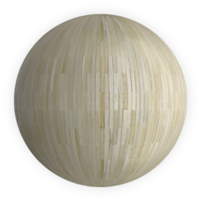</a> <b><a href="WoodFloor001">Wood Floor 001</a></b> by ambientCG · <a href="https://ambientcg.com/a/WoodFloor001">source</a> | <a href="WoodFloor002">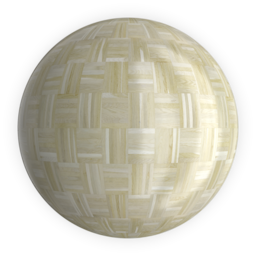</a> <b><a href="WoodFloor002">Wood Floor 002</a></b> by ambientCG · <a href="https://ambientcg.com/a/WoodFloor002">source</a> | <a href="WoodFloor003">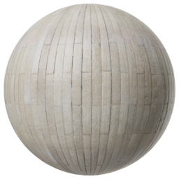</a> <b><a href="WoodFloor003">Wood Floor 003</a></b> by ambientCG · <a href="https://ambientcg.com/a/WoodFloor003">source</a> | <a href="WoodFloor004">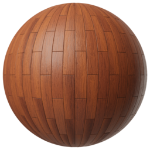</a> <b><a href="WoodFloor004">Wood Floor 004</a></b> by ambientCG · <a href="https://ambientcg.com/a/WoodFloor004">source</a> |
| <a href="WoodFloor005">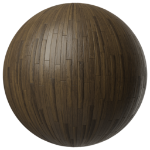</a> <b><a href="WoodFloor005">Wood Floor 005</a></b> by ambientCG · <a href="https://ambientcg.com/a/WoodFloor005">source</a> | <a href="WoodFloor006">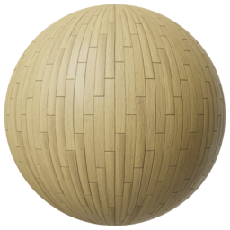</a> <b><a href="WoodFloor006">Wood Floor 006</a></b> by ambientCG · <a href="https://ambientcg.com/a/WoodFloor006">source</a> | <a href="WoodFloor007">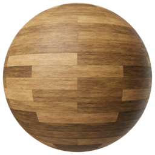</a> <b><a href="WoodFloor007">Wood Floor 007</a></b> by ambientCG · <a href="https://ambientcg.com/a/WoodFloor007">source</a> | <a href="WoodFloor008">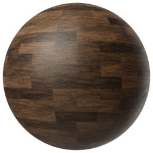</a> <b><a href="WoodFloor008">Wood Floor 008</a></b> by ambientCG · <a href="https://ambientcg.com/a/WoodFloor008">source</a> |
| <a href="WoodFloor009">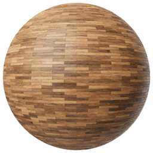</a> <b><a href="WoodFloor009">Wood Floor 009</a></b> by ambientCG · <a href="https://ambientcg.com/a/WoodFloor009">source</a> | <a href="WoodFloor010">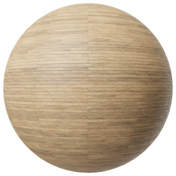</a> <b><a href="WoodFloor010">Wood Floor 010</a></b> by ambientCG · <a href="https://ambientcg.com/a/WoodFloor010">source</a> | <a href="WoodFloor011">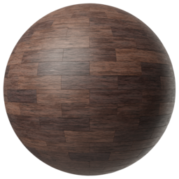</a> <b><a href="WoodFloor011">Wood Floor 011</a></b> by ambientCG · <a href="https://ambientcg.com/a/WoodFloor011">source</a> | <a href="WoodFloor012">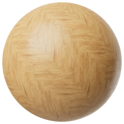</a> <b><a href="WoodFloor012">Wood Floor 012</a></b> by ambientCG · <a href="https://ambientcg.com/a/WoodFloor012">source</a> |
| <a href="WoodFloor013">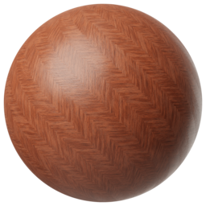</a> <b><a href="WoodFloor013">Wood Floor 013</a></b> by ambientCG · <a href="https://ambientcg.com/a/WoodFloor013">source</a> | <a href="WoodFloor014">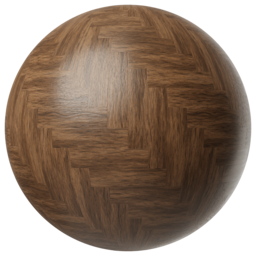</a> <b><a href="WoodFloor014">Wood Floor 014</a></b> by ambientCG · <a href="https://ambientcg.com/a/WoodFloor014">source</a> | <a href="WoodFloor015">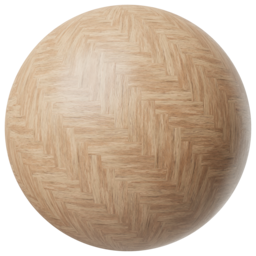</a> <b><a href="WoodFloor015">Wood Floor 015</a></b> by ambientCG · <a href="https://ambientcg.com/a/WoodFloor015">source</a> | <a href="WoodFloor016">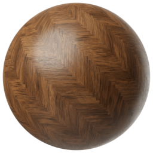</a> <b><a href="WoodFloor016">Wood Floor 016</a></b> by ambientCG · <a href="https://ambientcg.com/a/WoodFloor016">source</a> |
| <a href="WoodFloor017">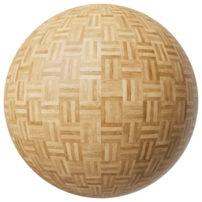</a> <b><a href="WoodFloor017">Wood Floor 017</a></b> by ambientCG · <a href="https://ambientcg.com/a/WoodFloor017">source</a> | <a href="WoodFloor018">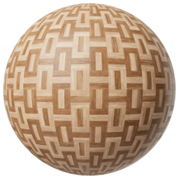</a> <b><a href="WoodFloor018">Wood Floor 018</a></b> by ambientCG · <a href="https://ambientcg.com/a/WoodFloor018">source</a> | <a href="WoodFloor019">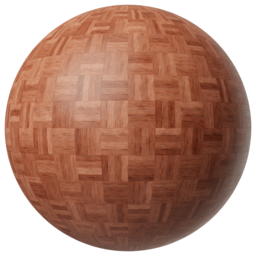</a> <b><a href="WoodFloor019">Wood Floor 019</a></b> by ambientCG · <a href="https://ambientcg.com/a/WoodFloor019">source</a> | <a href="WoodFloor020">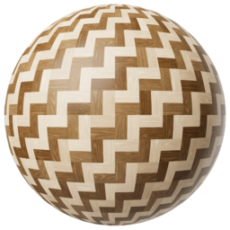</a> <b><a href="WoodFloor020">Wood Floor 020</a></b> by ambientCG · <a href="https://ambientcg.com/a/WoodFloor020">source</a> |
| <a href="WoodFloor021">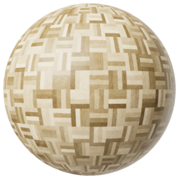</a> <b><a href="WoodFloor021">Wood Floor 021</a></b> by ambientCG · <a href="https://ambientcg.com/a/WoodFloor021">source</a> | <a href="WoodFloor022">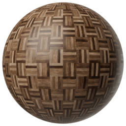</a> <b><a href="WoodFloor022">Wood Floor 022</a></b> by ambientCG · <a href="https://ambientcg.com/a/WoodFloor022">source</a> | <a href="WoodFloor023">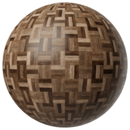</a> <b><a href="WoodFloor023">Wood Floor 023</a></b> by ambientCG · <a href="https://ambientcg.com/a/WoodFloor023">source</a> | <a href="WoodFloor024">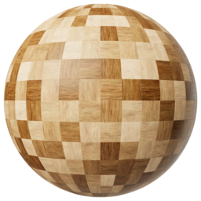</a> <b><a href="WoodFloor024">Wood Floor 024</a></b> by ambientCG · <a href="https://ambientcg.com/a/WoodFloor024">source</a> |
| <a href="WoodFloor025">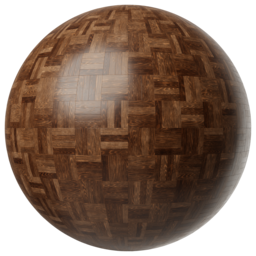</a> <b><a href="WoodFloor025">Wood Floor 025</a></b> by ambientCG · <a href="https://ambientcg.com/a/WoodFloor025">source</a> | <a href="WoodFloor026">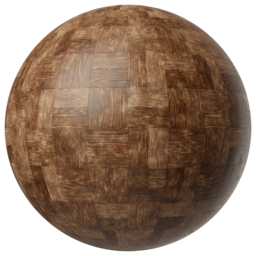</a> <b><a href="WoodFloor026">Wood Floor 026</a></b> by ambientCG · <a href="https://ambientcg.com/a/WoodFloor026">source</a> | <a href="WoodFloor027">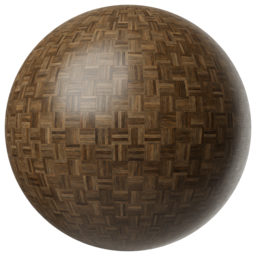</a> <b><a href="WoodFloor027">Wood Floor 027</a></b> by ambientCG · <a href="https://ambientcg.com/a/WoodFloor027">source</a> | <a href="WoodFloor028">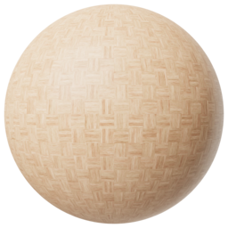</a> <b><a href="WoodFloor028">Wood Floor 028</a></b> by ambientCG · <a href="https://ambientcg.com/a/WoodFloor028">source</a> |
| <a href="WoodFloor029">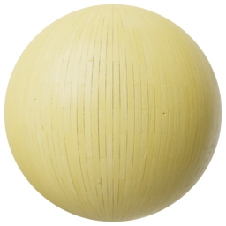</a> <b><a href="WoodFloor029">Wood Floor 029</a></b> by ambientCG · <a href="https://ambientcg.com/a/WoodFloor029">source</a> | <a href="WoodFloor030">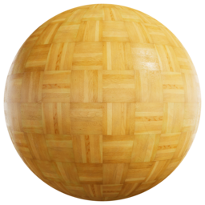</a> <b><a href="WoodFloor030">Wood Floor 030</a></b> by ambientCG · <a href="https://ambientcg.com/a/WoodFloor030">source</a> | <a href="WoodFloor031">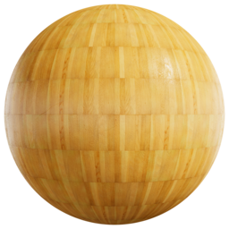</a> <b><a href="WoodFloor031">Wood Floor 031</a></b> by ambientCG · <a href="https://ambientcg.com/a/WoodFloor031">source</a> | <a href="WoodFloor032">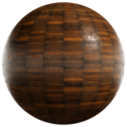</a> <b><a href="WoodFloor032">Wood Floor 032</a></b> by ambientCG · <a href="https://ambientcg.com/a/WoodFloor032">source</a> |
| <a href="WoodFloor033">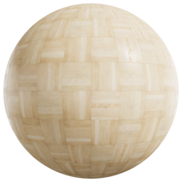</a> <b><a href="WoodFloor033">Wood Floor 033</a></b> by ambientCG · <a href="https://ambientcg.com/a/WoodFloor033">source</a> | <a href="WoodFloor034">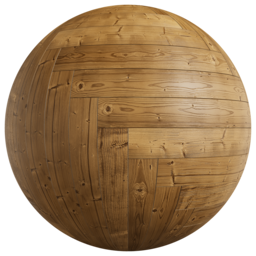</a> <b><a href="WoodFloor034">Wood Floor 034</a></b> by ambientCG · <a href="https://ambientcg.com/a/WoodFloor034">source</a> |  |  |

---

Kept up to date by this repository's own [update workflow](.github/workflows/update.yml), with code and plan from [cc0-mirror](https://github.com/zuujis-cc0/cc0-mirror). Something wrong? [Open an issue there](https://github.com/zuujis-cc0/cc0-mirror/issues/new) or use the [private report form](https://games.zuujis.com/report).
